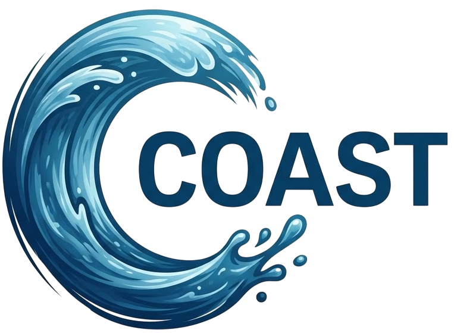
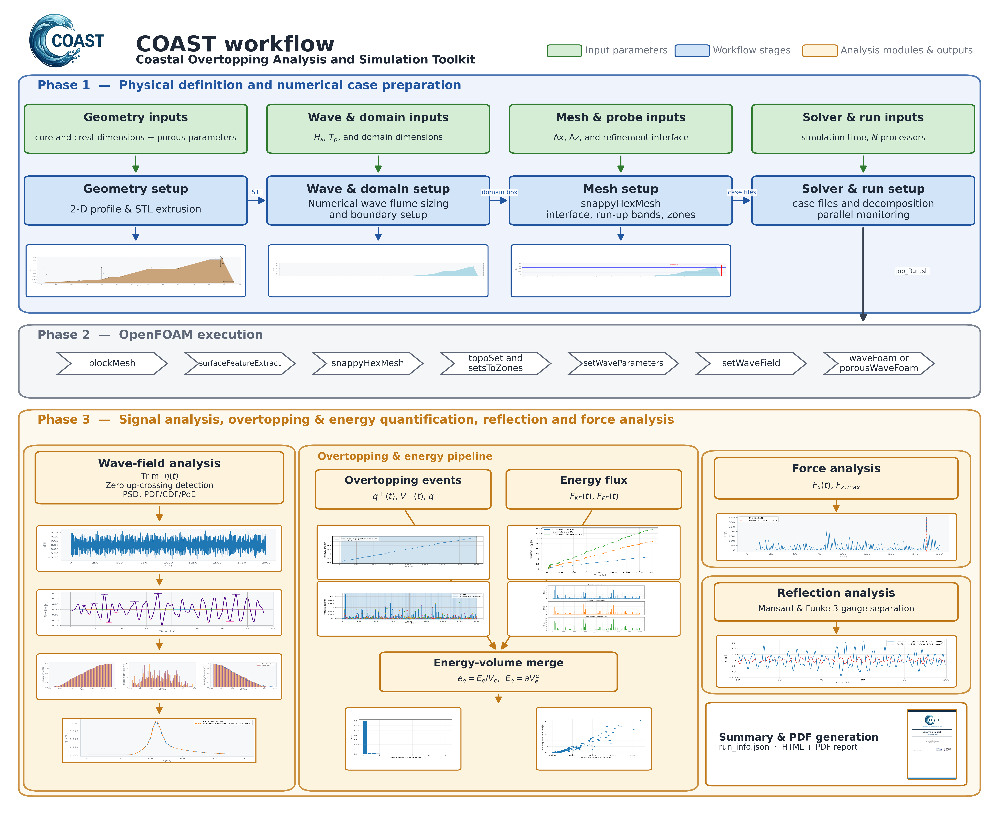

<p align="center">
  
</p>

<h1 align="center">COAST</h1>
<h3 align="center">Coastal Overtopping Analysis and Simulation Toolkit</h3>

<p align="center">
  <a href="#what-is-coast">About</a>
  <a href="#features">Features</a>
  <a href="#quick-start">Quick Start</a>
  <a href="#full-workflow">Workflow</a>
  <a href="#post-processing-10-tabs">Post-Processing</a>
  <a href="#repository-structure">Structure</a>
  <a href="#citation">Citation</a>
  <a href="#license">License</a>
  <a href="#authors">Authors</a>
</p>

---

> [!IMPORTANT]
> **COAST is research software, not a design tool.** It is provided **"as is", without
> warranty of any kind**. The author accepts **no responsibility for the results** it
> produces, nor for anything the software does on your system, nor for any decision
> taken on the basis of its output. Every result must be independently verified.
> COAST must **not** be used as the sole or primary basis for the design, assessment,
> or certification of any coastal structure or flood defence, nor for any decision
> affecting public safety, property, or the environment.
> See [LICENSE](LICENSE), [NOTICE](NOTICE) and the [manual](docs/Documentation%20Manual.pdf) for the full terms.

---

## What is COAST?

**COAST** is a Streamlit web application that automates the entire OpenFOAM pipeline for **wave overtopping** simulations on coastal structures (dikes, seawalls, rubble-mound breakwaters).

You provide physical parameters (slopes, wave height, water depth, crest freeboard) and COAST delivers a fully configured, running CFD case with quantitative post-processing. No manual file editing and no scripting are needed. The physical and numerical choices (mesh resolution, turbulence model, porous coefficients, roughness, simulated duration, event thresholds) still require engineering judgement; the user manual explains the defaults and how to choose them.

### Why COAST?

Setting up an OpenFOAM case for coastal engineering requires assembling dozens of configuration files: mesh dictionaries, boundary conditions, wave generation parameters, post-processing routines. Even for an expert, a single case takes hours. COAST solves this by:

- **Translating** physical parameters directly into a complete, ready-to-run OpenFOAM case
- **Automating** the full mesh pipeline (blockMesh, snappyHexMesh, extrudeMesh)
- **Launching** simulations in parallel via tmux with real-time monitoring
- **Providing** a 10-tab post-processing interface that mirrors the standard overtopping analysis workflow

---

## Full Workflow

<p align="center">
  
  <br/>
  <em>COAST workflow: Phase 1 (case preparation), Phase 2 (OpenFOAM execution), Phase 3 (post-processing)</em>
</p>

---

## Features

### Case Generation (6 Tabs)

| Tab | What it does |
|-----|--------------|
| **Geometry** | Define structure via EurOtop parameters, generate 3D STL, preview annotated cross-section |
| **Wave & Domain** | Set wave conditions (Hm0, Tp, JONSWAP), auto-size the numerical flume from STL + wavelength |
| **Mesh** | Configure blockMesh resolution, snappyHexMesh refinement bands (interface + runup), visual preview |
| **Simulation & Job** | Choose laminar or RANS (k-omega SST), time control, parallel decomposition, wall roughness |
| **Run** | One-click build (15-step pipeline) + launch in tmux + auto-generate HTML report |
| **Monitor** | Live dashboard for all cases: CPU%, RAM, progress bar, kill button, link to post-processing |

### Post-Processing (10 Tabs)

| Tab | Purpose | Data source |
|-----|---------|-------------|
| **1 Signals** | Raw free-surface elevation per gauge | `eta_from_freeSurface_x_*.txt` |
| **2 Trimming** | Transient removal (manual / auto-stationary) | same |
| **3 Wave Detection** | Zero-crossing wave identification | trimmed signals |
| **4 Statistics** | Wave-by-wave stats: Hs, H1/10, Hmax, PDF/CDF | detected waves |
| **5 Spectrum** | Welch PSD vs JONSWAP target, spectral Hm0, Tp, Tm-1,0 | trimmed signals |
| **6 Reflection** | Incident / reflected wave separation and reflection coefficient | trimmed signals |
| **7 Overtopping** | 3-step pipeline: event detection + energy flux + merged analysis | `postProcessing/overtopping/` |
| **8 Force** | Horizontal force Fx time series on structure | `postProcessing/forces/` |
| **9 Summary** | Per-gauge spectral parameters table | computed |
| **10 Compare** | Multi-case overlay of overtopping volume, Fx, energy flux | multiple cases |

---

## Quick Start

### Prerequisites

| Requirement | Details |
|-------------|---------|
| **OpenFOAM** | v2112 or v2206 with the [waves2Foam](https://openfoamwiki.net/index.php/Contrib/waves2Foam) library |
| **Python** | 3.9+ |
| **Python packages** | `numpy`, `numpy-stl`, `matplotlib`, `pandas`, `scipy`, `seaborn`, `streamlit`, `plotly`, `shapely` (see `requirements.txt`) |
| **tmux** | Installed automatically by `install.sh` |

### Install

```bash
git clone https://gitlab.coria-cfd.fr/ali.mahdi/COAST.git
cd COAST
./install.sh          # Install local tmux (no sudo) + add bin/ to PATH
source ~/.bashrc
```

### Environment Setup

COAST launches simulations inside **tmux sessions**. For tmux to inherit the OpenFOAM environment, both must be sourced in `~/.bashrc`:

```bash
# Add to ~/.bashrc:
source /path/to/OpenFOAM-v2206/etc/bashrc
source /path/to/waves2Foam/bin/bashrc
export PATH="$HOME/.local/bin:$PATH"
```

Each generated `job_Run.sh` re-sources these environments automatically, using the OpenFOAM / waves2Foam installation active in the shell where you start COAST (`$WM_PROJECT_DIR`, `$WAVES_DIR` or `$WM_PROJECT_USER_DIR`). If your installation is in a non-standard location, point COAST to it explicitly before launching:

```bash
export COAST_OPENFOAM_BASHRC=/path/to/OpenFOAM-v2206/etc/bashrc
export COAST_WAVES2FOAM_BASHRC=/path/to/waves2Foam/bin/bashrc
```

### Launch

```bash
export PYTHONPATH="$(pwd):$(pwd)/python_tools"
streamlit run coast_app.py
# Opens at http://localhost:8501
```

---

## Repository Structure

```
COAST/
├── coast_app.py                  # Main Streamlit app (case generation + monitoring)
├── pages/
│   └── postprocessing.py         # Post-processing page (10 tabs)
├── theme.py                      # Day/night theme + branded header
├── docs_content.py               # In-app documentation panels
│
├── python_tools/
│   ├── clash_cad.py              # EurOtop geometry to 2D polygon to 3D STL
│   ├── clash_plot.py             # Cross-section plotting with EurOtop labels
│   ├── canvas_tools.py           # Obstacle drawing, STL outline import, 2D union
│   ├── domain_tools.py           # Domain sizing from STL + Tp
│   ├── Mesh_plot.py              # Mesh and refinement-band preview
│   ├── foam_case_tools.py        # OpenFOAM dict manipulation (all dicts)
│   ├── tmux_run_case.py          # tmux session launcher + job script writer
│   ├── case_report.py            # run_info.json + HTML report (7 sections)
│   └── pdf_report.py             # PDF report generator
│
├── Rans_OF_Main/                 # RANS OpenFOAM template (k-omega SST)
│   ├── 0.orig/                   #   Boundary conditions (U, p_rgh, k, omega, nut, alpha)
│   ├── constant/                 #   Transport, turbulence, wave properties, porosityZones
│   ├── system/                   #   blockMeshDict, snappyHexMeshDict, controlDict, fvSchemes
│   ├── wave_analysis_py_functions/  # Wave analysis library
│   │   ├── reflection.py         #   Mansard & Funke 3-gauge separation
│   │   ├── spectrum.py           #   Welch PSD, spectral moments, JONSWAP
│   │   ├── waves.py              #   Zero-crossing wave detection
│   │   ├── stats.py              #   PDF, CDF, PoE, Rayleigh
│   │   └── stationarity.py       #   Stationarity detection and trimming
│   ├── OV_Test.py                #   Step 1: overtopping event detection
│   ├── kinetic.py                #   Step 2: energy flux computation
│   └── merge_OV_energy.py        #   Step 3: merged overtopping + energy analysis
│
├── Laminar_OF_Main/              # Laminar template (no turbulence model)
│
├── bin/
│   ├── joblist                   # CLI: monitor all running simulations
│   ├── killcase                  # CLI: terminate a simulation
│   └── rmcase                    # CLI: remove a case directory
├── install.sh                    # Setup script (tmux + PATH)
├── requirements.txt              # Python dependencies
├── LICENSE                       # CeCILL Free Software License Agreement, version 2.1
├── NOTICE                        # Copyright, licence summary, author's notice
└── docs/                         # User and technical manual (Documentation Manual.pdf)
```

---

## Citation

If COAST contributes to published work, please cite the article that describes it:

> Mahdi, A., Turki, I., Réveillon, J., Duret, B. and Demoulin, F.-X. (2026).
> COAST: An open-source framework for automated wave overtopping analysis and
> simulation of coastal structures. *Results in Engineering*, **32**, 113720.
> [doi:10.1016/j.rineng.2026.113720](https://doi.org/10.1016/j.rineng.2026.113720)

```bibtex
@article{Mahdi2026COAST,
  title   = {COAST: An open-source framework for automated wave overtopping
             analysis and simulation of coastal structures},
  author  = {Mahdi, Ali and Turki, Imen and R{\'e}veillon, Julien and Duret, Benjamin
             and Demoulin, Fran{\c c}ois-Xavier},
  journal = {Results in Engineering},
  volume  = {32},
  pages   = {113720},
  year    = {2026},
  doi     = {10.1016/j.rineng.2026.113720}
}
```

The repository also carries a [`CITATION.cff`](CITATION.cff) file, so GitHub offers
the same reference through its *Cite this repository* button.

---

## References

- EurOtop (2016). *Manual on wave overtopping of sea defences and related structures*. Second Edition. Van der Meer, J.W., Allsop, N.W.H., Bruce, T., De Rouck, J., Kortenhaus, A., Pullen, T., Schuttrumpf, H., Troch, P. and Zanuttigh, B. Available online: [www.overtopping-manual.com](https://www.overtopping-manual.com)

- Van Gent, M.R.A. (1995). *Wave interaction with permeable coastal structures*. Ph.D. Thesis, Delft University of Technology.

- Mansard, E.P.D. and Funke, E.R. (1980). *The measurement of incident and reflected spectra using a least squares method*. Proc. 17th Int. Conf. Coastal Engineering, 154-172.

- Jacobsen, N.G., Fuhrman, D.R. and Fredsoe, J. (2012). *A wave generation toolbox for the open-source CFD library: OpenFOAM*. Int. J. Numer. Meth. Fluids, 70(9), 1073-1088.

- Jensen, B., Jacobsen, N.G. and Christensen, E.D. (2014). *Investigations on the porous media equations and resistance coefficients for coastal structures*. Coastal Engineering, 84, 56-72.

---

## License

COAST is released under the **[CeCILL Free Software License Agreement](LICENSE)**, version 2.1.
Copyright (c) 2026 Ali Mahdi. `SPDX-License-Identifier: CECILL-2.1`

CeCILL v2.1 is a copyleft licence written under French law and compatible with the GNU GPL
(Article 5.3.4). You may use, study, modify and redistribute COAST. If you distribute COAST,
modified or not, you must keep its intellectual property notices and give the licence text
and the notice on warranty and liability with it, and a modified version must be distributed
under the same licence (Articles 5.3.1, 5.3.2 and 6.4).

See [`NOTICE`](NOTICE) for the copyright and a summary, [`LICENSE`](LICENSE) for the
binding text.

## Disclaimer

**COAST is research software, provided for research and educational purposes.
It is supplied "as is" (Article 9.3 of the licence).**

Articles 8 (Liability) and 9 (Warranty) of [`LICENSE`](LICENSE) govern. In particular,
**Article 9.1 places on the user** the responsibility for verifying the suitability of
the software for their requirements, its good working order, and that it causes no damage
to persons or property. Unlike a US-style blanket disclaimer, these provisions were
drafted to be effective under French law.

**No responsibility for results.** The author makes no representation or warranty of any
kind regarding the accuracy, reliability, completeness, or fitness for any purpose of any
output produced by this software - geometries, meshes, OpenFOAM cases, simulation results,
overtopping discharges, wave statistics, spectra, reflection coefficients, energy fluxes,
forces, reports, or figures. Numerical results depend on the mesh, the numerical schemes,
the turbulence closure, the porous-medium calibration, the wave generation and absorption
settings, the record length, and the choices made by the user. **All results must be
independently verified before any use.**

**Not for design.** COAST is **not** a design tool and must **not** be used as the sole or
primary basis for the design, assessment, certification, or operation of any coastal
structure, flood defence, or other engineering work, nor for any decision affecting public
safety, property, or the environment. Any such use is entirely at the user's own risk and
remains the sole responsibility of the user and of the qualified engineer signing off on
the work.

**No responsibility for software behaviour.** The author accepts no responsibility for
anything the software does on your system - creating, modifying, or deleting files and
directories, launching or terminating processes and tmux sessions, consuming CPU, memory,
disk, or cluster resources, or interacting with third-party software. You are responsible
for reviewing the code, backing up your data, and operating the software within the rules
of your computing environment.

**Third-party software and data.** COAST orchestrates independent third-party software it
does not include or license to you, including OpenFOAM, waves2Foam, and the Python
scientific stack, each governed by its own licence and warranty disclaimer. COAST is not
approved or endorsed by OpenCFD Ltd (ESI Group), producer of the OpenFOAM software and
owner of the OPENFOAM trademark. The EurOtop experimental database and the EurOtop manual
are the property of their respective owners and subject to their own terms of use.

In no event shall the author be liable for any claim, damages, or other liability arising
from, out of, or in connection with the software or its use. See [LICENSE](LICENSE) for
the complete terms.

---

## Authors

**Ali Mahdi** (ali.mahdi@coria.fr)

CNRS UMR 6614 CORIA, Universite de Rouen Normandie

---

<p align="center">
  
  &nbsp;&nbsp;&nbsp;&nbsp;&nbsp;
  
</p>
